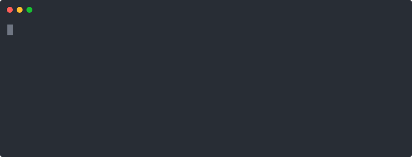

<p align="center">
  <a href="https://kickbucket.dev"></a>
</p>

<h3 align="center">The Nmap for cloud storage.</h3>
<p align="center">Find exposed S3, GCS and Azure buckets fast. Open source, written in Go.</p>

<p align="center">
  <a href="https://github.com/cyberactivelabz/kickbucket/stargazers"></a>
  <a href="LICENSE"></a>
  <a href="https://github.com/cyberactivelabz/kickbucket/releases"></a>
  <a href="https://github.com/sponsors/cyberactivelabz"></a>
</p>

<p align="center">
  <a href="https://kickbucket.dev">Website</a> ·
  <a href="https://docs.kickbucket.dev">Docs</a> ·
  <a href="https://discord.gg/kickbucket">Discord</a> ·
  <a href="https://github.com/cyberactivelabz/kickbucket/discussions">Discussions</a>
</p>



---

> **Status: early development.** The engine and the S3, GCS and Azure providers are being built toward v0.1. Interfaces may change until v1.0. Watch or star the repo to follow along.

## What it does

Misconfigured cloud storage is one of the most common ways data leaks. Kickbucket takes a keyword (a company, product or project name), generates likely bucket names from it and a wordlist, checks each one across cloud providers in parallel, and tells you how exposed each bucket is.

| Access level | Meaning |
|---|---|
| `public read` | Objects can be read without credentials |
| `listable` | The bucket's contents can be listed without credentials |
| `private` | The bucket exists and denies anonymous access |

## Features

- **Fast:** a concurrent Go engine with configurable rate limits and timeouts.
- **Multi-cloud:** S3, GCS and Azure, behind one provider interface. Adding a provider is a single package.
- **Use it your way:** CLI, local web GUI, or import it as a Go library.
- **Scriptable:** clean plain-text and JSON output for pipelines.
- **Bring your own wordlists:** or use the built-in defaults.

## Install

```sh
go install github.com/cyberactivelabz/kickbucket/cmd/kickbucket@latest
```

Prebuilt binaries for Linux, macOS and Windows (amd64 and arm64) are on the [releases page](https://github.com/cyberactivelabz/kickbucket/releases).

## Quick start

```sh
kickbucket scan acme
```

Example output (illustrative):

```
Only scan cloud storage you own or are explicitly authorized to test.
s3    acme-backups                   LISTABLE
azure acme-logs                      LISTABLE
gcs   acme-assets                    PRIVATE
3 buckets found, 2 exposed
```

More in the [docs](https://docs.kickbucket.dev): [CLI](https://docs.kickbucket.dev/cli) · [Web GUI](https://docs.kickbucket.dev/web-gui) · [Go library](https://docs.kickbucket.dev/api) · [Wordlists](https://docs.kickbucket.dev/wordlists)

## Providers

| Provider | Status |
|---|---|
| Amazon S3 | Implemented |
| Google Cloud Storage | Implemented |
| Azure Blob Storage | Implemented |
| DigitalOcean Spaces, Backblaze B2, Wasabi | Wanted: [add one](CONTRIBUTING.md) |

## Responsible use

Use Kickbucket only on assets you own or are explicitly authorized to test. Finding an exposed bucket does not give you permission to download or modify its contents. If you find someone else's exposed data, report it to the owner through their disclosure program.

## Contributing

The easiest ways in are adding a cloud provider or a wordlist. Read [CONTRIBUTING.md](CONTRIBUTING.md) and open a "New provider" issue to get started. Questions go in [Discussions](https://github.com/cyberactivelabz/kickbucket/discussions).

## Sponsors

Kickbucket is MIT licensed and funded by sponsors. [Become a sponsor](https://github.com/sponsors/cyberactivelabz) to get your name or logo here and on [kickbucket.dev](https://kickbucket.dev).

## Contributors

<a href="https://github.com/cyberactivelabz/kickbucket/graphs/contributors">
  
</a>

## License

[MIT](LICENSE)
